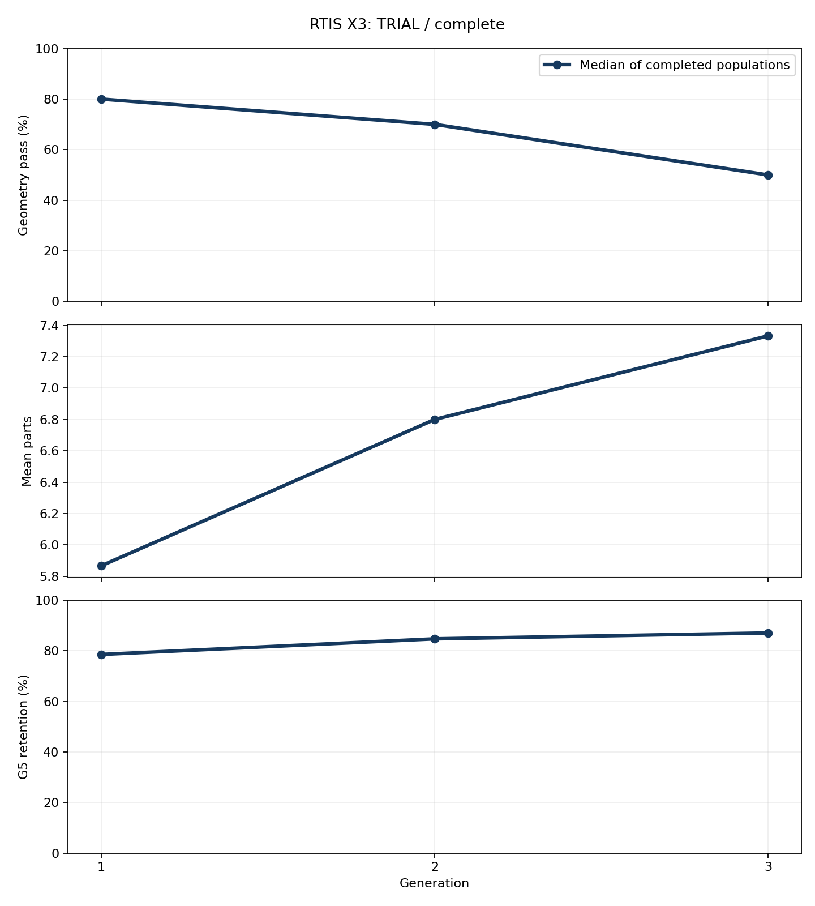

# RTIS v1 X3 多代（只描述）

模式：試跑（不納入正式結果）

狀態：complete

X3 已完成。

不做檢定。G5 是各子代相對於直接雙親的保留比例之平均，不是對初始六形體的累積保留。
合格率分母固定 30；錯誤算不合格。不完整代的其他均值留白，不進中位數與範圍。
seconds 是該族群該代已嘗試子代的耗時總和（非 X4 生成效能測試）。

| 代 | 完整族群數 | 合格率中位數 %（最小–最大） | 平均部位數中位數（最小–最大） | G5 中位數 %（最小–最大） |
|---|---:|---|---|---|
| 1 | 1 | 80.000（80.000–80.000） | 5.867（5.867–5.867） | 78.588（78.588–78.588） |
| 2 | 1 | 70.000（70.000–70.000） | 6.800（6.800–6.800） | 84.756（84.756–84.756） |
| 3 | 1 | 50.000（50.000–50.000） | 7.333（7.333–7.333） | 87.092（87.092–87.092） |

淡線為各族群、粗線為完整族群的中位數；取消時僅為部分試跑診斷。

環境、亂數鍵、程式雜湊及停止原因見 manifest；逐子代紀錄見 x3_generations_v1_children。
